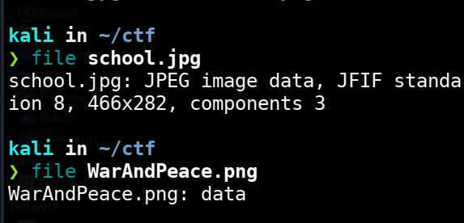
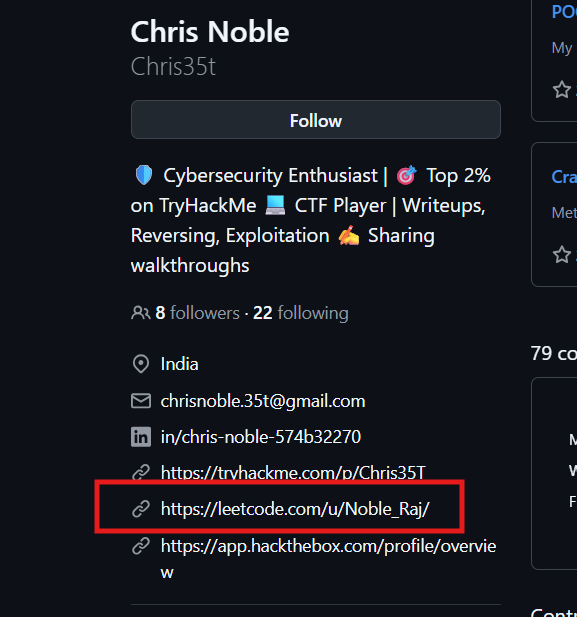
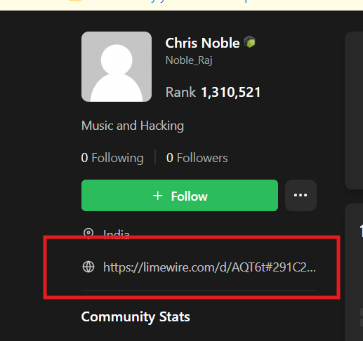
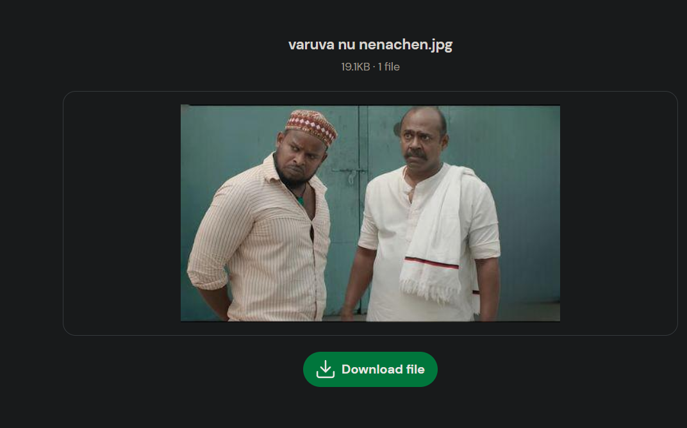

# Walkthrough

# Day 1 Challenge -A Picture Is Worth Two Fragments.

## **Challenge Info**

- **Category:** Forensics
- **Author:** KULL4N4R1

### **Description**

Two files, two fragments, one hidden truth. Looks can be deceiving, and the clues are
hiding in places most people overlook.

Can you uncover both fragments and piece together the flag?

…

From the attachment provided, we got two images. 

school.jpg and WarAndPeace.png

Looking into their file data, we can see the jpg is a real jpg file but png is not.



Let’s focus on the jpg image first.

```bash
exiftool school.jpg
```

Using exiftool to inspect the metadata, we can see there is a comment embedded in it.


This might be a key or a hint, so let’s keep that in mind..

After poking around it, I used binwalk and found a lead.

```bash
binwalk school.jpg
```


There is actually another jpeg image embedded in it and it is at offset 90092, let’s extract it.

```bash
dd if=school.jpg of=hidden.jpg bs=1 skip=90092 status=none

```


After poking around it and looking at its metadata, I used stegseek to inspect it.

```bash
stegseek hidden.jpg
```


So that’s what the comment is for, the ‘taliban’ is the passphrase.

Let’s extract it with steghide.

```bash
steghide extract -sf hidden.jpg -p taliban
```


And looking at the recovered text, we got the first part of the flag. 

```bash
WiCySxEx0rcists{
```

Now, let’s look at the png image.


Using `pngcheck` shows its corrupted, so let's look at the hex dump using `xxd` to verify its file signature.

```bash
xxd -g1 WarAndPeace.png | head -n 10
```


And we found the blacksheep…

The file begins with 00 50 4e 47

But a  valid PNG begins with 89 50 4e 47, so let’s change it.

You can use a lot of tools to change it and can even use scripts to change it, Imma just gonna use the hexedit tool.

```bash
hexedit WarAndPeace.png
```


After correcting the hex recovers the original png file.


And looking at the image file, we got the next part of the flag.


So the final flag is

```bash
WiCySxEx0rcists{truth_survives_erasure}
```

# **Day 2 Challenge**

## **Challenge Info**

- **Category:** Misc

### **Description**

Can you Connect the dots, Hunt for clues, Explore the digital trail, Search for the study, and Solve the mystery left by one of the challenge authors, who has been engrossed in a serious study on a royal battlefield game?

…

With no attachments or files, let’s consider this an OSINT challenge

From the description, two things stand out… we need to find the challenge author, and we need to figure out what the "royal battlefield game" is.

At first I had weird thoughts like, maybe its PUBG and the author found some vulnerability in it and did serious study on it?

Then my brain went "Clash Royale?" Then "Age of Empires?”

But then i took a closer look at the question and realized something…

Its CHESS!


The capital letter of each sentences screams chess and the description also matches, so its chess

"Royal battlefield game" = chess. We know the game. 

Now we need a person.

The description says it's "one of the challenge authors." We don't know which one. 

So I went to take another look at the challenge Linkedin post


Stared at the names and the Ex0rcists names felt suspicious. 

Picked a victim. Karthik D, top of the list, why not.

Went through his LinkedIn, poked around his GitHub. Nothing screaming "I hid a flag in a chess game." 

At this point I figured, fine, let me just search the man.


Seems like we hit a jackpot with our first guess

So Karthik D is a chess player and his FIDE ID is 46614869


But hold on… is this Karthik D the same as Ex0rcists Karthik D? Anyone can be named Karthik and play chess. 

I needed a link between the two people.

So I went back to his linkedin and I noticed a pattern


Same handle. Everywhere. This is the kind of consistency that makes OSINT people happy. 

I ran Sherlock on `karthiksiky` and…


This confirms Karthik D is indeed a chess player

In the description, it is mentioned that the author is engrossed in deep study of chess


I found this website called [https://lichess.org/](https://lichess.org/) where chess people post their ‘study’


But I couldn’t find anything with that username in lichess, so we hit a dead end.

So… Karthik D is a chess player, but he is not the chess player we wanted.

The author is someone else.

So with this username thing in mind, I thought of doing username enumeration with all members of the Ex0rcists team.

I decided to see the [https://www.linkedin.com/company/ex0rcists/](https://www.linkedin.com/company/ex0rcists/) linkedin page for more clues.

Found their ctftime link 


And there are many members in teams, like 


So I used a small bash script to try every username and see if they have a lichess account

```bash
users=(
  shy@m r0hB0t user403 DarZer Caity Lu7ifer karthiksiky v1gn35h
  ShaZ w4nn4d13 uh4ck3r h3is3nb3rg G3ntl3m3n 0xy_D3vil
  vigneshwarans3224 chrisnoble.35t pr4s4nn4 HA3R1SH 5h4lv1n
)

check_user() {
    local u="$1"
    local enc="${u//@/%40}"
    local code
    code=$(curl -L --max-time 6 -sS -o /dev/null -w "%{http_code}" \
           "https://lichess.org/@/$enc" 2>/dev/null)

    if [[ "$code" == "200" ]]; then
        echo "$u FOUND"
    else
        echo "$u no ($code)"
    fi
}

for u in "${users[@]}"; do
    check_user "$u" &
done
wait
```

Found five matches

```python
w4nn4d13    FOUND
ShaZ        FOUND
h3is3nb3rg  FOUND
uh4ck3r     FOUND
Caity       FOUND
```

And after looking through them, I found the one with a recent study.

That's him. That's our guy.


And we found the study


‘Kodi Vilayatu’ further confirms, we are right


We then download the pgn for local inspection


After some time of research… I got a lead.

Every chess position has a certain number of legal moves. 

Depending on where the pieces are, that could be 20 moves, or 30, or 5, or whatever. The player picks one. Normally you'd just say "he played Nf3" and move on.

But if you're hiding a flag in a chess steganography…

1. List all the legal moves in that position.
2. Sort them and look at the index of the move that was *actually* played.
3. That index is a number. How many bits can it hold? `floor(log2(n))` bits, where `n` is the number of legal moves.
4. Append those bits to a growing bitstream.
5. Do this for every move in the game.
6. When you're done, read the bitstream 8 bits at a time as ASCII.

So the entire game is secretly one long binary string, disguised as normal-looking chess. 

It's called chess steganography, and there's a public tool for it.

 https://github.com/WintrCat/chessencryption

```python
python [cli.py](http://cli.py/) decode /home/kali/Downloads/lichess.pgn recovered
```


```
WiCySxEx0rcists{5athur4ng4_v3tt4i}
```

……………………………………

# Day 3 Challenge - Rasgulla

## Challenge Information

- **Category:** Miscellaneous
- **Author:** ShaZ

### Challenge Description

A flag is hidden inside an ordinary file using multiple layers of encoding and concealment. The message may look unfamiliar, but every transformation follows a recognizable pattern.

Think in bits, and remember that your fingers may know the answer better than your eyes.

Can you unravel the layers and recover the original flag?

…

We were given an attachment containing this cute AI-generated rasgulla image.


Let's begin with some basic steganography analysis.

I tried several tools, including `exiftool`, `binwalk`, `xxd`, `StegSolve`, `zsteg`, and `steghide`. I also uploaded the image to a couple of online steganography analysis tools:

- [Aperi'Solve](https://www.aperisolve.com/)
- [StegOnline](https://georgeom.net/StegOnline)

But, none of these gave anything useful.

Next, I tried [StegSolve](https://stegotoolkit.com/steganography/stegsolve) to inspect the image's different bit planes.

This gave me a suspicious indication of possible LSB.


After researching tools that could extract data using this technique, I came across [Stegify](https://github.com/DimitarPetrov/stegify).

I used Stegify to decode the image

```
stegify decode --carrier rasgulla.png --result extracted
```


The command produced an output file of approximately 1873 bytes.

This looked like Base64-encoded data, so the next step was to decode it.

I decoded the extracted file

```
base64 --decode extracted > bits.txt
```

The result was a long sequence consisting entirely of `0`s and `1`s.


There are several possibilities to investigate and I experimented with different ones, like

- 8-bit ASCII
- 5-bit Bacon's cipher
- 6-bit Braille
- 7-bit text
- 9-bit framing
- Parity-based encodings
- Morse code
- Binary bitmap layouts

However, none of these approaches revealed the flag.

After some additional research, I came across an encoding called Binaryfuck.

And no, I'm not even kidding. That's literally its name. BINARYFUCK!

I headed straight to [dCode's Binaryfuck decoder](https://www.dcode.fr/binaryfuck-language) and fed it the binary string.


The output was

```
EoVuDcRc-tvodyd}jj4+u-i+d-;b4f+,4+%y4h2gu+e-m|
```

This still looked like gibberish, but the challenge description gave me another important clue.

> Remember that your fingers may know the answer better than your eyes.
> 

That line made me suspect a keyboard shift cipher.

I used [dCode's Keyboard Shift Cipher tool](https://www.dcode.fr/keyboard-shift-cipher) to test this theory.

I selected the QWERTY keyboard layout and applied the appropriate decryption direction.


And voila! We finally recovered the flag.

```
WiCySxEx0rcists{hh3_y0u_s0lv3d_m3_$t3g1fy_w0n}
```

This one was quite an insane challenge, I did a lot of circles after getting the binary.

It literally is…

BINARYFUCK!

………………………………………………………………………………………

# **Day 4 Challenge - Ryoiki Tenkai**

## **Challenge Info**

- **Category:** Forensics / Misc
- **Author:** V1K

### **Description**

Bits and bytes are everywhere. Follow the havoc to find the flag from the roots of this attachment. Reveal the flag that you can't see.

…

---

So the attachment is a 1.31-minute `.mov` video of Sukuna's domain expansion from Jujutsu Kaisen.

IT IS PEAK BTW.

Anyway, back to the challenge.

Reading the description, it doesn't sound like the flag is hidden in the video frames or anything like that. 

So I started by checking the file type and metadata, then ran `strings` on it:

```bash
strings Ryoiki\ Tenkai.mov
```


Found something interesting like `apskdhoajioz/hdlsa` at the end

Decided to inspect the actual bytes at the end.

```bash
tail -c 700 "Ryoiki Tenkai.mov" | xxd -g1
```


After a few minutes of poking around and researching, I found another lead.


Normally, ZIP archives use the signatures `50 4b 01 02` for central directory records and `50 4b 03 04` for local file headers. But I saw this…

```json
00000150: 3f 02 01 4b 50 00 00 00
```

That made me suspect the video might contain an embedded ZIP archive whose bytes was reversed.

My next step was to extract the suspicious trailing data and reverse its byte order

But first, we need to find where the MOV ends so we don't accidentally reverse part of the video and isolate the suspicious archive.

You can use tools like `ffprobe` or `mp4dump`, but I just used a simple Python script.

---

```python
python3 - <<'PY'
from pathlib import Path
data = Path("Ryoiki Tenkai.mov").read_bytes()
pos = 0
while pos + 8 <= len(data):
    size = int.from_bytes(data[pos:pos+4], "big")
    kind = data[pos+4:pos+8]
    header = 8
    if size == 1:
        size = int.from_bytes(data[pos+8:pos+16], "big")
        header = 16
    if not all(32 <= b <= 126 for b in kind):
        break
    if size == 0:
        size = len(data) - pos
    if size < header or pos + size > len(data):
        break
    print(pos, kind.decode("ascii"), size, "end", pos + size)
    pos += size
print("Trailing offset:", pos)
print("Trailing length:", len(data) - pos)
PY
```

which gives us the result


---

The final declared box ended at byte offset `138183570`, but the file itself contained another 499 bytes after that point.

Now lets extract them and reverse the bytes to check if we get a zip file.

```bash
dd if="Ryoiki Tenkai.mov" of=trailer.bin \
bs=1 skip=138183570 status=none
```

I used perl to reverse the bytes

```bash
perl -0777 -ne 'print scalar reverse $_' trailer.bin > reversed.bin
```


Now we can see ZIP bytes.

```bash
00000020: 6c 64 68 2f 50 4b 03 04 14 00 ...
```


But even after reversing the bytes, we still cant unzip it and it shows error.

After staring at it for a while, found the problem.

```bash
xxd -g1 reversed.bin
```

---


The archive seems to have deliberately corrupted ZIP signatures.

A healthy ZIP file has a very specific structure, and the signatures are basically landmarks that tell any tool "hey, a new section starts here." If those landmarks are wrong, the whole thing falls apart.

The magic bytes were swapped out with garbage.

Now let's repair the two corrupted ZIP signatures.

```python
python3 - <<'PY'
from pathlib import Path
data = bytearray(Path("reversed.bin").read_bytes())
assert data[:4] == bytes.fromhex("01 02 03 04")
assert data[36:40] == b"PK\x03\x04"
assert data[271:275] == b"PK\x01\x02"
assert data[359:363] == b"PK\x01\x02"
assert data[459:463] == bytes.fromhex("03 04 05 06")
data[:4] = b"PK\x03\x04"
data[459:463] = b"PK\x05\x06"
Path("repaired_payload.zip").write_bytes(data[:481])
print("Created repaired_payload.zip")
print("Size:", len(data[:481]), "bytes")
PY
```


Great, now we have a working ZIP,  but it asks for a password.

---

Let’s try bruteforcing it with `fcrackzip` and `rockyou.txt`

```bash
fcrackzip -v -D -u -p /usr/share/wordlists/rockyou.txt repaired_payload.zip
```


Got the password. Unzipped the file and found... 


Apparently I am the DRAGON WARRIOR!


Jokes aside …


`ls -l` shows 638 bytes for such a small file.

Running `xxd -g1` and `cat -A` shows that after the first line, the file is composed entirely of lines containing only spaces (`0x20`) and tabs (`0x09`), terminated with `\r\n`  that is `^M$` under `cat -A`

---

Each line has exactly 8 characters, and those characters are only spaces or tabs. So each line is basically a byte in binary… space = `0`, tab = `1`. 

Read all 8 bits, convert to a character, and you get the hidden message.

To decode this, we use another Python script

```python
python3 - <<'PY'
from pathlib import Path
data = Path('/asldh/zoijaohdkspa').read_bytes()
out = []
for line in data.splitlines()[1:]:
    assert len(line) == 8 and set(line) <= {32, 9}
    bits = line.replace(b' ', b'0').replace(b'\t', b'1')
    out.append(chr(int(bits, 2)))
cipher = ''.join(out)
Path('ciphertext.txt').write_text(cipher + '\n')
print(cipher)
PY
```

And this gives us something.


```
HiBwWvIi0rbgwrw{574YD_OP0YB_C0F_F0TEL7_U17L_7S3_BX735_U3PJ}
```

Finally… something close to a flag. Fucking hell.

---

Matching it against the flag format `WiCySxEx0rcists{...}`, I identified it as a Vigenère cipher.


But to decode Vigenère we need the key. I tried the ‘lazyeye’, using the ZIP password as the key and guess what...


Finally got the flag.

```
WiCySxEx0rcists{574ND_PR0UD_Y0U_F0UGH7_W17H_7H3_BY735_W3LL}
```

There is another way to confirm the key is ‘lazeye’ without guessing.

That is by comparing the cipher text prefix with the known flag prefix. 

Remove the digit from both, map letters to A=0 through Z=25, and calculate `(ciphertext - plaintext) mod 26`.

```python
cipher = "HiBwWvIi0rbgwrw"
plain  = "WiCySxEx0rcists"
key = []
for c, p in zip(cipher, plain):
    if c.isalpha() and p.isalpha():
        k = (ord(c.upper()) - ord(p.upper())) % 26
        key.append(chr(k + ord('A')))
    else:
        key.append('?')  # non-letter, skip
print(''.join(key))
```


……………………………………………………………….

# **Day 5 Challenge - The Prince Who Never Became The King**

## **Challenge Info**

- **Category:** Misc
- **Author:** sh4d0wkh4n

### **Description**

They called him the Prince, a magician with the ball and an heir to a throne he would never claim.

A fortune, a legendary number, and a legacy of what might have been. Some stories end in glory; others leave behind unanswered questions.

Time has blurred the past, but not every trace has faded. What appears ordinary may hold a different truth, and silence is rarely as empty as it seems.

…

After downloading the provided attachment we got Picture.jpeg file, lets look through it.

I started by running `strings` to look for readable text or embedded file signatures.

```python
strings Picture.jpeg
```

While looking at the strings, at the end I found something interesting.


There is a png file and a wav audio file and maybe they are in a zip

So lets extract it with binwalk

```python
binwalk -e Picture.jpeg
```


Tried to unzip it with 7z and obviously its password protected.


Time to crack it.

The archive seems to use AES encryption, so I used John the Ripper to extract the password hash and attempt a dictionary attack using `rockyou.txt`.

```python
zip2john 2D99B.zip > hash.txt
```

```python
john hash.txt --wordlist=/usr/share/wordlists/rockyou.txt
```


We cracked it and the password is neymar.

And that password fits the football-related hints in the challenge description rather nicely.

After extracting it, there is the png and wav file we found earlier.


Lets look at the .wav file first and open it using audacity tool

```python
audacity recording-10.wav
```


At first, the audio itself didn't reveal the information we needed. 

Since the challenge description mentioned that silence is rarely as empty as it seems, I decided to inspect the audio spectrogram.

So let’s set it to spectorgram.


After some research and tweaks, finally found a lead.

In the Spectrogram settings, set scale to linear, put minimum frequency to 12000 and max frequency to 22050 and color scheme to grayscale.


After resizing it, we found a QR code


Using an online qrcode to text [https://www.imagetotext.info/qr-code-scanner](https://www.imagetotext.info/qr-code-scanner) we got one part of the flag


```python
15_N3YM4R_JR_5P34K1NG!!!!!!!
```

Next, I opened the extracted PNG file.

The image looked distorted and twisted around a central point.


After researching how to reverse this kind of distortion, I found that ImageMagick's `magick` command supports a `-swirl` operation.

```python
magick IMG-10.png -swirl 1000 swirl.png
```

We got the part 1 of the flag


```python
H3Y_TH15_
```

Using the challenge's expected flag format, we can construct the final flag:

```python
WiCySxEx0rcists{H3Y_TH15_15_N3YM4R_JR_5P34K1NG!!!!!!!}
```

……………………

# **Day 6 Challenge - Lost Coordinates**

## **Challenge Info**

- **Category: Miscellaneous**
- **Author:** RK

### **Description**

A strange sequence of numbers was recovered from an unknown source. It may look meaningless, but there's a destination hidden inside it.

Your task is to decode the message, investigate the information it reveals, and identify the zoo.

—

From the attachment provided, we got a string of digits


For this challenge, I went circles and circles a lot of times.

Base4? Octal? DNA codons? Nope. 

In my opinion, author opened [CyberChef](https://gchq.github.io/CyberChef/), scrolled through the operations list, and picked whatever looked fun.

And you know what? It works. 

The chain is weird, arbitrary, and held together with duct tape and hope… but it decodes to a real URL pointing at a real zoo.

Here's the full Cyberchef recipe.

```jsx
[
{ "op": "Remove whitespace",
"args": [true, true, true, true, true, false] },
{ "op": "Find / Replace",
"args": [{ "option": "Regex", "string": "^(.)(.*)$" }, "$2$1", true, false, true, false] },
{ "op": "From Hex",
"args": ["None"] },
{ "op": "Rail Fence Cipher Decode",
"args": [2, 0] },
{ "op": "From Binary",
"args": ["Space", 8] },
{ "op": "Bit shift right",
"args": [1, "Logical shift"] },
{ "op": "Find / Replace",
"args": [{ "option": "Simple string", "string": "<" }, "=", true, false, true, false] },
{ "op": "From Base64",
"args": ["A-Za-z0-9+/=", true, false] },
{ "op": "URL Decode",
"args": [true] }
]
```

So the order is

1. Remove whitespace
2. Rotate first char to end
3. From Hex, delimiter `None`
4. Rail Fence Decode, 2 rails, offset 0
5. From Binary, space-delimited, 8 bits
6. Bit shift right, 1, logical
7. Replace `<` with `=`
8. From Base64
9. URL Decode


```jsx
[https://www.zoo-leipzig.de/en/your-visit/map-of-the-zoo/](https://www.zoo-leipzig.de/en/your-visit/map-of-the-zoo/)
```

And so yeah, the flag is

```jsx
WiCySxEx0rcists{[zoo-leipzig](https://www.zoo-leipzig.de/en/your-visit/map-of-the-zoo/)}
```

………………………………………………….

# **Day 7 Challenge - Seedmania**

## **Challenge Info**

- **Category:** Reverse engineering/Miscellaneous
- **Author:** chris35t

### **Description**

illusionnnnnnnn

—

The challenge attachment file was a single `.rar` file. 

I tried `7z x chall.rar`, but it failed with `Unsupported Method`. 

It looks like the archive was made with a newer RAR version, so I used a different tool.

```bash
sudo apt install -y libarchive-tools
bsdtar -xf chall.rar
```


That gave me two files`vault` and `findtheflag.mp4` 

I decided to start with `vault`. It is small and I can actually run and inspect it, while the video is big and might just be a rabbit hole.

I didn't want to jump straight into anything complicated, so I started with `strings`, which prints all the readable text inside a file. 

Just think of it as skimming a file for clues.

```bash
strings -n 6 vault | head -60
```

And fromthe results, three things caught my eye

→ Lots of "lua" names like `luaL_loadbuffer`. 

→ Lua is a small scripting language, so the program probably runs a Lua script. 

→ A name called `ptrace`. I know this is sometimes used to stop people from debugging a program but I didn’t confirm it.

→A weird block of the letter `Z` repeated over and over. 


I remembered that XOR is a simple way to scramble data as every byte gets mixed with one secret number or the key. 

The letter `Z` is `0x5A` in computer terms. So my guess was that the hidden Lua script is scrambled with the key `0x5A`. If I was wrong, unscrambling would just give me gibberish.

I wanted a way to check my guess. 

Aftera little research I learned that, compiled Lua scripts always start with the same few bytes `1B 4C 75 61 51`, which spells out "Lua". 

If my guess is right, those same five bytes should be sitting somewhere in `vault`, but scrambled with `0x5A`.

First I worked out what the scrambled version should look like, using a bash one liner that XORs each byte with `5a`

```jsx
for b in 1b 4c 75 61 51; do printf '%02x ' $((0x$b ^ 0x5a)); done; echo
```


Then I searched the file for exactly those bytes. 

`grep` can do this with the `-obUaP` options, which print only the match, show its byte position, and treat the file as binary.

```jsx
grep -obUaP "\x41\x16\x2f\x3b\x0b" vault
```


It found a match at position 12416. 

So the scrambled Lua header is really in the file, and my `0x5A` guess was right.

To confirm it further, I looked at the bytes at that position with `xxd`

```bash
xxd -s 12416 -l 16 vault
```


Hmm, two things stood out. 

The line starts with `41 16 2f 3b 0b`, which is the scrambled Lua header. 

After that come lots of `5a`, which are the zeros scrambled into the key, exactly like the `Z` runs I noticed earlier. 

Now that I knew where the script starts and what the key is, I decoded it. 

This command cuts the file at position 12416, XORs every byte with `5a`, and then uses `strings` to show only the readable text:

```bash
dd if=vault bs=1 skip=12416 2>/dev/null | perl -0777 -pe '$_ ^= "\x5a" x length' | strings -n 4
```


So it points to author’s github itself.

Let’s just try executing it for the funsies.


Now that we have double confirmed it, lets go and look at the author’s profile.

After looking through his github for a while… found a lead.



His LeetCode page had another link.



And inside that link, there is an image.



Since its a jpg file, I probed it with tool related to it… and I finally got a hit with the `jsteg` tool.


```graphql
jsteg reveal output.jpg
```

The text says, the flag is here… yes, it literally is there.

But the output looked suspiciously long, so I ran it through `cat -A`, which shows invisible characters. 

It was full of sequences like `M-bM-^@M-^L`. Those are zero-width Unicode characters like U+200C, U+200D, U+202C and U+FEFF hidden between the letters of the visible sentence.


This is Unicode steganography. 

I saved the output to a file and decoded it with the same js library that powers [https://330k.github.io/misc_tools/unicode_steganography.html](https://330k.github.io/misc_tools/unicode_steganography.html), running it through node so I didn’t need the browser.

I tried to copy and paste it in browser, but it ain’t working.

```graphql
jsteg reveal output.jpg > hidden.txt
```

```graphql
curl -O https://330k.github.io/misc_tools/unicode_steganography.js

node -e 'const s=require("./unicode_steganography.js").unicodeSteganographer; const r=s.decodeText(require("fs").readFileSync("hidden.txt","utf8")); console.log(r.hiddenText)’
```

Which gives us the flag


```
WiCySxEx0rcists{kacha_mango_adicha_veengo}
```

………….

# **Day 7 Challenge Walkthrough - Forgotten Access**

## **Challenge Info**

- **Author:** w4nn4d13

### **Description**

They buried the evidence. They erased the trail. But they forgot one thing — access.

What begins as an ordinary security advisory leads into a maze of forgotten projects, mysterious artifacts, and secrets hidden in plain sight.

Not every discovery is an answer. Not every flag is real. Some trails lead nowhere, while others reveal fragments of something much bigger.

The deeper you investigate, the more you realize that nothing was left behind by accident.

Follow the breadcrumbs. Question everything. Trust nothing.

Some secrets were never meant to be found. Others were simply waiting for the right person.

…

The author already wrote a full step-by-step writeup here [https://w4nn4d13.tech/posts/the-forgetten-acess/](https://w4nn4d13.tech/posts/the-forgetten-acess/), so I won’t copy every command. 

And to be honest, this was the hardest challenge among the ten.

Most challenges test one skill but this one tests all of them. 

The category for this challenge is… everything.

It starts with OSINT, then goes into hidden data inside an AI model, then reverse engineering, then GitHub forensics, with crypto mixed in the whole way.  

Honestly… this one was a brainfuck challenge for me.

…………….

# **Day 9 Challenge - Ghost's Last Trace**

## **Challenge Info**

- **Category:** Firmware
- **Author:** 0xy_D3vi1

### **Description**

We seized a router from a suspect's apartment during a raid. The forensics team pulled the firmware off the flash chip before the device was powered down. Intel suggests the suspect was hiding something inside the device itself. Our analysts ran the usual tools but came up empty. Whatever is in there, it wasn't meant to be found easily. Dig deeper. Not everything is what it appears to be.

—

In the attachment provided, we got `firmware.bin`

Before doing anything, lets do the static triage

```bash
file firmware.bin
xxd firmware.bin | head -20
strings -n 8 firmware.bin | head
```


`file` only says `data`, so it does not know this format. 

The first bytes spell `NRFW`, then `NetRouter Pro v2.1` and a date, `2024-06-15`. 

Nothing else is readable.

The start of the file is probably a label that explains the rest, so I decided to look at the header first.

A header is like the label on a box. It often says where the real contents start.

```bash
xxd -l 0x60 firmware.bin   
```


| Position | What is there | Meaning |
| --- | --- | --- |
| `0x00` | `NRFW` | The file's own marker |
| `0x04` | `NetRouter Pro v2.1` | Product name |
| `0x20` | `2024-06-15` | Build date |
| `0x30` | `00 10 00 00` | The number 4096. This is where the real data starts |
| `0x34` | `00 20 04 00` | The number 270336. This is how long the data is |
| `0x38` | `ef be ad de` | `deadbeef`, a classic joke marker |
| `0x3C` | `d3 4d f0 0d` | Reads like 'dead food'. Hmm, suspicious. |

You may think how did I get 4096 and 270336 from those random bytes?

Computers store numbers backwards in a format called Little Endian. 

To read them, you have to flip the bytes from right to left.

→ Finding the Data Start (`00 10 00 00`)

- Flip the bytes. Reading `00 10 00 00` backwards gives you `00 00 10 00`.
- Drop the useless zeros at the front, leaving you with `1000` in Hex.
- And do the math, In Hex, each position is a power of 16. The `1` is in the 4th position, which represents 16^3 or 16 times x 16 times x 16.
- Result is 4096.

→ Finding the Data Length (`00 20 04 00` )

- Flip the bytes: Reading `00 20 04 00` backwards gives you `00 04 20 00`.
- Drop the leading zeros, leaving you with `42000` in Hex.
- Do the math:
    - The `4` is worth 4 x 16^4 = 262144
    - The `2` is worth 2 x 16^3 = 8192
    - Add them together: 262144 + 8192 = 270336.

---

Let’s see if the header is tellingthe truth.

The total size of the file should be 274432 bytes

When checking the actual size of `firmware.bin` on my machine, it is exactly 274432 bytes. The header layout maps out the file perfectly.


Every single field in this header has a clear job, except for that last one: `d3 4d f0 0d` (`deadfood`).

It is most likely a password, an XOR key, or some hint.

The header says the real data starts at 4096 (`0x1000`). 

Everything between the header and that point is just padding, so we skip it. 

Let’s look at what is at that position:

```bash
xxd -s 0x1000 -l 32 firmware.bin
```


Many file types start with a fixed marker like this, called magic bytes. 

They tell you what kind of file it is and `hsqs` is the marker for SquashFS, a compressed bundle of folders that routers use. 

Think of it as a zip file holding the router’s `/etc`, `/www` and other folders.

```bash
binwalk firmware.bin
```

Using `binwalk` on it further confirms it.


→ Cutting it out

Now we copy everything from position 4096 onward into its own file

```bash
dd if=firmware.bin of=fs.sqsh bs=4096 skip=1
```


→ Opening it

```bash
unsquashfs -d rootfs fs.sqsh

```


```
ls -laR rootfs
```

The `-a` in `ls -laR` matters because it shows hidden files, and that is where the author hid things.


Lot of files…

The odd one out is `/usr/bin/diagnostics` 268 KB, while everything else is tiny.

`/etc/.backup.conf` contains a line like this:

```
# recovery_token=V2lDeVN4RXgwcmNpc3Rze3IwdXQzcl9mMXJtdzRyM19oNGNrfQ==
```

The `==` at the end shows this is base64 and decoding it gives…

```bash
echo 'V2lDeVN4RXgwcmNpc3Rze3IwdXQzcl9mMXJtdzRyM19oNGNrfQ==' | base64 -d
 
WiCySxEx0rcists{r0ut3r_f1rmw4r3_h4ck} 
```

It looks exactly like a flag but is a decoy…

Let’s continue our enumeration.

`/var/log/auth.log` also has a `token=` value

```bash
echo 'dG9vIGVhc3k/IHRyeSBoYXJkZXI=' | base64 -d

too easy? try harder
```

The author is telling us the first one was bait.

`/usr/bin/.debug_key` says `debug_key=AB00AB00AB00AB00`. 

I tried it as a key on the big file and got garbage. Dead end.

### Other things I noted

- `/tmp/.diag_cache` holds a long encoded value. I could not decode it, and I did not need it.
- `/www/.htpasswd` has password hashes that look like placeholders. I did not try to crack them.
- `/etc/device.conf` says `hw_serial=c0ffee42`which might be important.

Now, let’s look at the main dish…

What I know about `/usr/bin/diagnostics`


1. The router can run it `run_diag.sh --check`, so a key to unscramble it must exist.
2. `run_diag.sh --verify` contains this comment, which is the big clue.

```bash
# hw_bind: concat /dev/mtd0[0x3C:4] + /dev/eeprom/serial
```

In plain words… the key is 4 bytes from position `0x3C` of the flash chip which is our `firmware.bin` followed by the device serial number.


The 4 bytes at `0x3C` are `d3 4d f0 0d`. That is the suspicious field during our triage.

The serial is `c0ffee42`, from `device.conf`.

My guess was that the key is `d34df00d` followed by `c0ffee42`, so `d34df00dc0ffee42`. 

The scrambling is probably XOR.

Let’s just test the guess before doing the whole file. 

Unscramble just the first 4 bytes and see if they look like a known file type.

```python
b = open('rootfs/usr/bin/diagnostics','rb').read()
k = bytes.fromhex('d34df00dc0ffee42')
print(bytes(c ^ k[i % 8] for i, c in enumerate(b[:4])).hex())    # 1f8b0800
```


`1f 8b 08 00` is the marker of a gzip ****file, like zip. 

So, it worked!

Let’s unscramble the whole file. You can also use cyberchef for this, meh… let’s just finish this with a script.

```python
k = bytes.fromhex('d34df00dc0ffee42')
b = open('rootfs/usr/bin/diagnostics','rb').read()
open('diag.gz','wb').write(bytes(c ^ k[i % 8] for i, c in enumerate(b)))
```

```bash
gunzip -c diag.gz > diag.elf
chmod +x diag.elf
file diag.elf
```

`file` now says it is a 64-bit ARM Linux program (ELF). So the hidden file was a program all along.


If you ever need to guess an unknown XOR key, the tool `xortool` can help. We did not need it here.

It is built for ARM chips, not a normal PC, so run it with an emulator called QEMU.

```bash
sudo apt install qemu-user
```

```bash
qemu-aarch64 ./diag.elf
```


```bash
strings -n 6 diag.elf
```


The program refuses to run and mentions `ctf-device`. 

Seems like it checks the computer's name and only works if it is `ctf-device`.

Let’s just fake the computer name so the program thinks it is on the right device.

```bash
sudo unshare --uts sh -c 'hostname ctf-device; qemu-aarch64 ./diag.elf'
```


```bash
WiCySxEx0rcists{0xy_k@_huKum}
```

…………………….

# **Day 10 Challenge - Boss fight**

## **Challenge Info**

- **Category:** OSINT /Miscellaneous
- **Author:** Chris35t

### **Description**

Somewhere in a forum where people join together the flag is scattered ,

Find all the parts and place words between underscores.

—

Ok, so it’s an OSINT challenge…. and from the description it says its on a forum page.

For this challenge, I looked through a lot thinking its some forum website or something, but it actually is the discord server created for this challenge.

So now we have to look through every nook and corner of this discord to find the flag.

Got the first one from the pfp of the discord server.


It says ‘thanks’ at the top right corner. It is one part of the flag.

After that, looking at the pinned messages… we got the next clue.


It is unicode stegnography, so I used this site [https://330k.github.io/misc_tools/unicode_steganography.html](https://330k.github.io/misc_tools/unicode_steganography.html)


Which gives us the next part of the flag ‘for playing’ 

The third part of the flag is in the emoji itself and using an emoji decode tool can get us the text.

[https://emoji.paulbutler.org/?mode=decode](https://emoji.paulbutler.org/?mode=decode)


So the third part of the flag is WiCyS x Ex0rcists.

Now for the fourth part of the flag, it is in the soundboard.


Let’s download the file, so we can inspect it further.


For this, I used a audio steganography tool called audacity.

Opened the audio file in audacity and changed its setting to spectogram to look at hidden texts.


From just changing it to spectrogram, we can already see some letters


I tweaked the spectogram settings to get a better look


It is very unclear but we can make it out somehow and tell its ‘ctf player’.

So arranging all the flag parts and wrapping it around the flag format gives us teh final flag.

```bash
WiCySxEx0rcists{thanks_for_playing_Wicys_x_Ex0rcists_ctf_soldier}
```
